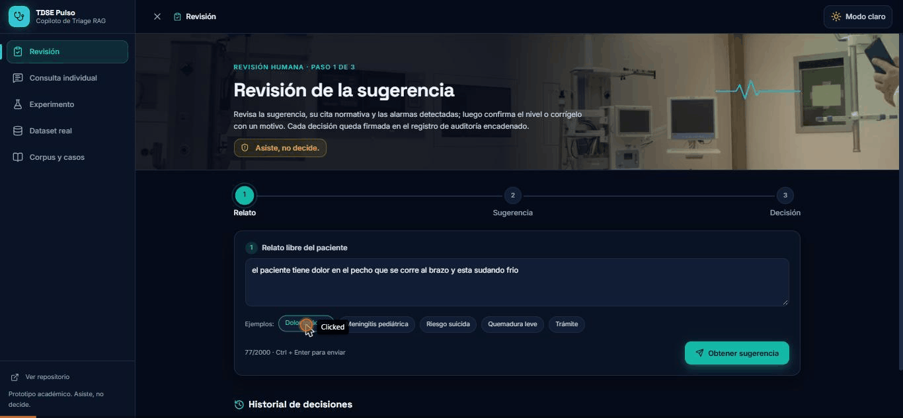
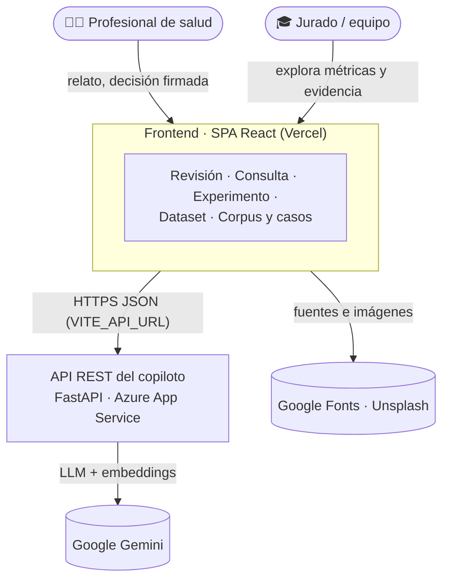
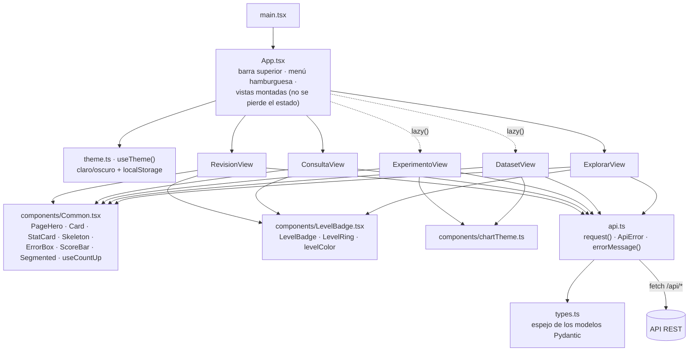
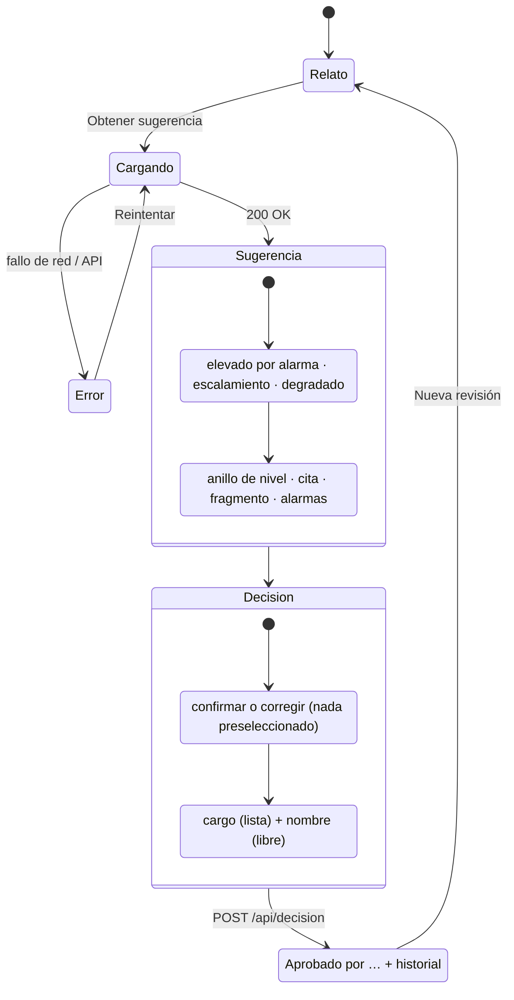
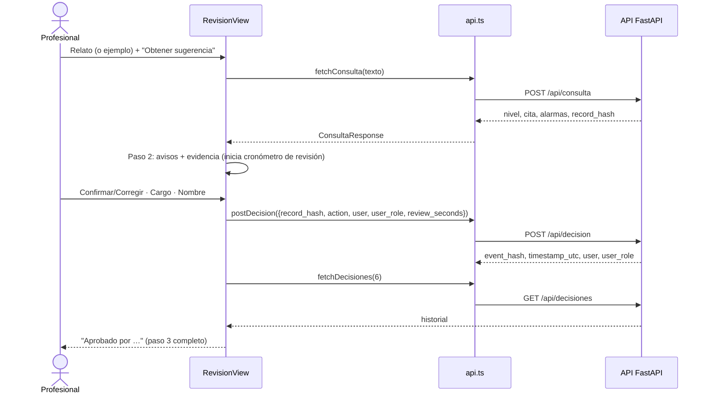
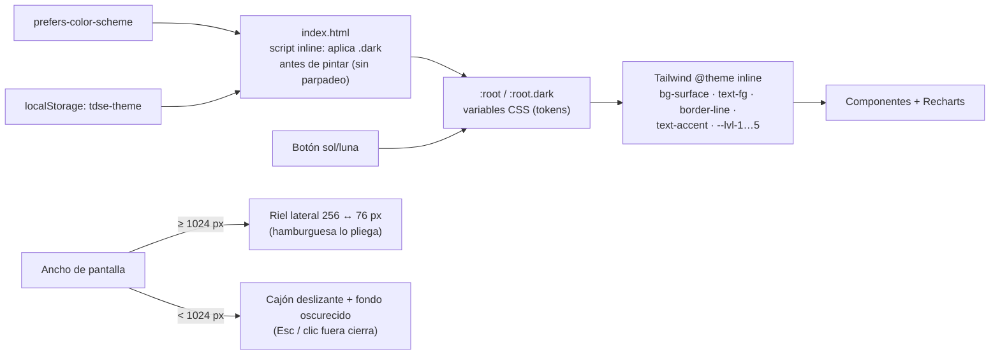

# TDSE · Copiloto de Triage RAG — Frontend

[](https://github.com/AnaFiquitiva/TDSE_Copiloto_Triage_Frontend/actions/workflows/ci-cd.yml)


Interfaz web del copiloto de triage RAG: el profesional de salud escribe el
relato del paciente, revisa la sugerencia (nivel I–V con su cita normativa,
alarmas y fragmentos recuperados) y **firma su decisión con nombre y cargo**.
Incluye además vistas de laboratorio, experimento, dataset real y corpus.

> **Asiste, no decide.** Prototipo académico: no usar para decisiones clínicas reales.

| | Enlace |
|---|---|
| App en producción (Vercel) | https://tdse-copiloto-triage-frontend.vercel.app |
| API que consume (repositorio aparte) | [TDSE_Copiloto_Triage_Backend](https://github.com/AnaFiquitiva/TDSE_Copiloto_Triage_Backend) · [Swagger](https://tdse-triage-api-g5bwanajb9egc7ax.brazilsouth-01.azurewebsites.net/docs) |

### Demostración



*Relato de ejemplo "Dolor torácico" → nivel II con su cita y alarma → confirmación
firmada por "Médico/a de urgencias" → "Aprobado por …" en el historial →
cambio a modo claro → menú contraído con la hamburguesa → vista Experimento.*

**Video de la API en Swagger:** está en el
[README del backend](https://github.com/AnaFiquitiva/TDSE_Copiloto_Triage_Backend#demostración-en-swagger)
([`docs/media/swagger-backend-demo.gif`](https://github.com/AnaFiquitiva/TDSE_Copiloto_Triage_Backend/blob/main/docs/media/swagger-backend-demo.gif)).

---

## Tabla de contenido

1. [Resumen](#1-resumen)
2. [Objetivos](#2-objetivos)
3. [Tecnologías: back-end y front-end](#3-tecnologías-back-end-y-front-end)
4. [Arquitectura](#4-arquitectura)
5. [Patrones de diseño](#5-patrones-de-diseño)
6. [Integridad de datos](#6-integridad-de-datos)
7. [Seguridad](#7-seguridad)
8. [Calidad y pruebas](#8-calidad-y-pruebas)
9. [Evidencias](#9-evidencias)
10. [Instalación y ejecución](#10-instalación-y-ejecución)
11. [Referencia de la API REST](#11-referencia-de-la-api-rest)
12. [Estructura del proyecto](#12-estructura-del-proyecto)
13. [Cumplimiento del reto](#13-cumplimiento-del-reto)
14. [Identidad visual y fuentes](#14-identidad-visual-y-fuentes)
15. [Referencias](#15-referencias)

---

## 1. Resumen

Capa de presentación del copiloto de triage. No contiene lógica clínica:
todo el razonamiento (recuperación, LLM, guardarraíl, auditoría) vive en la API
del backend. El frontend se encarga de que la **revisión humana sea clara,
rápida y responsable**:

- Flujo guiado en **3 pasos**: Relato → Sugerencia → Decisión.
- Avisos que no se pueden pasar por alto: **nivel elevado por regla de
  alarma**, **escalamiento** por abstención y **modo degradado**.
- Decisión con **elección activa** (nada preseleccionado) y firma obligatoria:
  **cargo** (lista fija) + **nombre** (texto libre, nunca precargado).
- Confirmación "**Aprobado por** … / **Corregido por** …" e **historial de
  decisiones**.
- **Modo claro/oscuro**, **menú hamburguesa** (riel plegable en escritorio,
  cajón en móvil), imágenes y microanimaciones; totalmente **responsive**.

### Cinco vistas

| Vista | Para quién | Qué hace |
|---|---|---|
| **Revisión** | Profesional de salud | Relato → sugerencia (anillo de nivel, cita, fragmento citado, alarmas) → decisión firmada → historial |
| **Consulta individual** | Equipo técnico | Laboratorio: cambia corpus, recuperación y generador; compara con la línea base C0 |
| **Experimento** | Jurado | KPIs, gráfico por celda y tabla E1–E6 + C0 con explicación de cada métrica |
| **Dataset real** | Jurado | ~89 000 registros de Datos Abiertos Colombia: distribución, tiempos y mapa de calor por red de IPS |
| **Corpus y casos** | Jurado | Buscador (sin tildes) y filtros de las 74 viñetas; visor de los 31 fragmentos citables |

## 2. Objetivos

**General.** Ofrecer una interfaz web que convierta la sugerencia del copiloto
en una decisión humana informada, trazable y firmada, accesible desde
escritorio, tablet y móvil.

**Específicos.**

1. Mostrar la sugerencia con su **evidencia** (cita y fragmento íntegro) y las
   alarmas, priorizando visualmente los avisos de seguridad.
2. Exigir una **decisión explícita** y registrar **quién** la toma (cargo +
   nombre libre).
3. Hacer visible la **transparencia** del sistema: experimento, dataset real,
   corpus y casos de prueba.
4. Cumplir criterios de **usabilidad y accesibilidad** (contraste AA, objetivos
   táctiles ≥ 44 px, navegación por teclado, `prefers-reduced-motion`).
5. Desplegar de forma continua en **Vercel** consumiendo la API en Azure.

## 3. Tecnologías: back-end y front-end

### Front-end (este repositorio)

| Tecnología | Versión | Uso |
|---|---|---|
| **React** | 19 | Componentes y estado |
| **TypeScript** | 6 | Tipos en espejo de los modelos Pydantic de la API |
| **Vite** | 8 | Dev server con proxy `/api` y build; *code splitting* de vistas con gráficos |
| **Tailwind CSS** | v4 | Tokens del sistema "Pulso" (`@theme`), variante `dark` por clase |
| **Recharts** | 3 | Gráficos con colores que siguen el tema |
| **lucide-react** | — | Iconos |
| **clsx** | — | Clases condicionales |
| **oxlint** | — | Linter |
| **Vitest** + **Testing Library** + **jsdom** | 5 / 16 / 29 | Pruebas automatizadas de la interfaz |
| **Vercel** / **nginx** (Docker) | — | Despliegue / servido estático |
| **Google Fonts** · **Unsplash** | — | Tipografías e imágenes de las bandas superiores |

### Back-end ([repositorio aparte](https://github.com/AnaFiquitiva/TDSE_Copiloto_Triage_Backend))

| Tecnología | Uso |
|---|---|
| **Python 3.12** + **FastAPI** + **Pydantic** | API REST con OpenAPI/Swagger |
| **Google Gemini** | LLM y embeddings de la ruta principal |
| BM25 + embeddings + RRF | Recuperación híbrida |
| Auditoría JSONL con hash encadenado | Trazabilidad de sugerencias y decisiones |
| **Azure App Service** + **GitHub Actions** | Despliegue y CI/CD |
| CDS Hooks + HL7 FHIR R4 | Interoperabilidad opcional |

## 4. Arquitectura

### 4.1 Diagrama de contexto (C4 · nivel 1)



### 4.2 Componentes de la SPA



### 4.3 Flujo de la vista Revisión (estados)



### 4.4 Secuencia: revisión firmada



### 4.5 Temas y diseño responsive



## 5. Patrones de diseño

| Patrón | Dónde | Para qué |
|---|---|---|
| **Container / Presentational** | Vistas (`*View.tsx`) vs. `Common.tsx`, `LevelBadge.tsx` | Separar datos/estado de la presentación reutilizable |
| **Custom hooks** | `useTheme`, `useCountUp`, `useChartTheme`, `useIsDesktop` | Encapsular comportamiento transversal |
| **Design tokens** | `index.css` (`:root`, `.dark`, `@theme inline`) | Un único origen de color, tipografía y sombras para ambos temas |
| **Facade / API client** | `api.ts` (`request`, `ApiError`, `errorMessage`) | Un solo punto de acceso HTTP, errores uniformes en español |
| **DTO tipados** | `types.ts` | Contrato en espejo de Pydantic; el compilador detecta desajustes |
| **Lazy loading / code splitting** | `lazy()` en `App.tsx` | Recharts solo se carga al abrir Experimento o Dataset (carga inicial 670 → 287 KB) |
| **Keep-alive de vistas** | `App.tsx` (vistas ocultas con `hidden`) | No perder el relato ni una decisión a medio llenar al cambiar de pestaña |
| **State machine implícita** | `RevisionView` (`step = done ? 3 : result ? 2 : 1`) | Flujo guiado y barra de progreso coherente |
| **Progressive disclosure** | "Detalles técnicos y fragmentos" plegable | Ocultar hash y ruta técnica hasta que se necesiten |
| **Skeleton screens** | `Skeleton` en todas las cargas | Percepción de rapidez y estructura estable |
| **Mapeo de códigos a lenguaje** | `reasonText()`, `backendText()` | Traducir códigos internos a frases claras |

## 6. Integridad de datos

- **Contrato tipado** con la API (`types.ts`): campos obligatorios, uniones
  literales (`'confirma' | 'corrige'`, `BackendUsed`) y `null` explícito.
- **Decisión válida antes de enviar:** el botón solo se habilita si hay
  elección, nivel y motivo (al corregir), **cargo** y **nombre ≥ 2 caracteres**;
  su texto dice exactamente qué se registrará ("Registrar: confirma nivel II").
- **Nada precargado:** ni la decisión ni la persona; cada revisión exige una
  firma activa.
- **El nivel no se calcula en el cliente:** se muestra el `n_final` de la API;
  si una regla lo elevó, se explica de qué nivel a cuál y por qué alarma.
- **Trazabilidad:** cada decisión referencia el `record_hash` de la sugerencia
  mostrada (una tarjeta nueva por consulta, `key={record_hash}`) y envía el
  tiempo real de revisión.
- **Límites coherentes con la API:** relato ≤ 2000, motivo ≤ 1000, nombre ≤ 120
  caracteres (`maxLength`).
- **Gráficos honestos:** Recall@k de C0 se muestra como "no aplica" (null), no
  como 0; los KPIs dicen de qué celda es cada mejor valor.

## 7. Seguridad

| Control | Implementación |
|---|---|
| Sin secretos en el cliente | La única configuración es `VITE_API_URL` (pública); la clave de Gemini vive solo en el backend |
| Origen autorizado | La API solo acepta el dominio de Vercel por CORS |
| Sin HTML inyectado | Todo el contenido se renderiza como texto con React (sin `dangerouslySetInnerHTML`) |
| Datos en la URL | Ningún dato personal en la URL; el hash (`#revision`) solo indica la vista |
| Almacenamiento local mínimo | `localStorage` solo guarda el tema y el estado del menú, en `try/catch`; el nombre del revisor **no** se guarda |
| Errores sin detalles internos | Mensajes en español; en 5xx se muestra solo un código corto (`request_id`) para soporte |
| Enlaces externos | `rel="noreferrer"` en enlaces con `target="_blank"` |
| Límite de tasa | Respetado por la API (429 con mensaje claro y botón "Reintentar") |

## 8. Calidad y pruebas

| Verificación | Comando | Resultado |
|---|---|---|
| **Pruebas automatizadas de la interfaz** | `npm test` | ✅ **14 pruebas** en 4 archivos |
| Tipos (TypeScript estricto) + build | `npm run build` | ✅ sin errores (incluye los tipos de las pruebas) |
| Linter | `npm run lint` | ✅ sin errores (solo avisos de estilo) |
| Auditoría de dependencias | `npm audit` | ✅ 0 vulnerabilidades |
| CI | GitHub Actions en cada PR y push: lint → pruebas → build | ✅ |
| Prueba end-to-end manual | Navegador contra la API local y producción | ✅ (ver Evidencias) |

### Pruebas automatizadas (Vitest + Testing Library)

La API se simula con un `fetch` falso (`src/test/fixtures.ts`): ninguna prueba
llama a la red. Se prueban comportamientos visibles para el usuario, no
detalles internos.

| Archivo | Qué verifica |
|---|---|
| `src/views/RevisionView.test.tsx` (7) | Aviso destacado de **nivel elevado por regla** y fragmento citado limpio · **ninguna persona precargada** · el botón exige decisión, **cargo** y **nombre** (≥ 2 caracteres) y su texto dice qué se registrará · confirmación enviada con `user`/`user_role` y "**Aprobado por** …" + recarga del historial · corrección exige nivel y motivo ("**Corregido por** …") · abstención escala y bloquea "Confirmar" · aviso de modo degradado · error 429 con "Reintentar" |
| `src/App.test.tsx` (3) | Modo claro/oscuro y persistencia · la **hamburguesa** contrae/expande el menú (`aria-expanded`) · el relato **no se pierde** al cambiar de pestaña |
| `src/api.test.ts` (3) | Fallo de red → mensaje en español · errores 422 de Pydantic legibles · 500 con código corto del `request_id` |
| `src/views/ExplorarView.test.tsx` (1) | Búsqueda **sin tildes** ("niño" encuentra "nino") y filtros por nivel |

Se comprobó que las pruebas detectan regresiones reales: al quitar a propósito
la exigencia de cargo, la suite falla.

Comprobado además end-to-end en el navegador:

- Flujo completo de Revisión con la API real: sugerencia nivel II, alarma
  detectada, decisión firmada (cargo + nombre) y entrada en el historial.
- Modo claro/oscuro, persistencia de la elección y transición suave.
- Menú hamburguesa: riel plegable en escritorio y cajón en un ancho de 390 px.
- Experimento, Dataset y Corpus sin errores en consola; búsqueda "niño"
  encuentra los relatos escritos "nino".

**Accesibilidad:** `lang="es"`, contraste AA en ambos temas, `aria-current` en
el menú, `role="radiogroup"`/`aria-checked` en las decisiones, `role="tablist"`
y `aria-pressed` en filtros, `role="alert"` en avisos críticos, foco visible,
objetivos ≥ 44 px y animaciones desactivadas con `prefers-reduced-motion`.

## 9. Evidencias

- **Video de la app** (arriba): [`docs/media/frontend-demo.gif`](docs/media/frontend-demo.gif).
- **Video de Swagger** de la API: en el
  [README del backend](https://github.com/AnaFiquitiva/TDSE_Copiloto_Triage_Backend#demostración-en-swagger).
- **Producción verificada** (15 nov 2026): la app en Vercel sirve la versión
  nueva (`lang="es"`, tema persistente) y su dominio pasa el preflight CORS de
  la API (200).
- **CI/CD en verde**: lint → **14 pruebas de interfaz** → build → despliegue a Vercel en cada push a `main`.
- **Diseño:** propuestas y versión elegida ("Pulso guiado") generadas en
  Superdesign; sistema de diseño en `.superdesign/design-system.md`.

## 10. Instalación y ejecución

Requiere **Node.js 22+** y la API del backend corriendo.

```bash
# 1) Backend (en su repositorio)
pip install -r web/backend/requirements.txt
uvicorn web.backend.app:app --reload --port 8000

# 2) Frontend (este repositorio)
git clone https://github.com/AnaFiquitiva/TDSE_Copiloto_Triage_Frontend.git
cd TDSE_Copiloto_Triage_Frontend
npm install
npm run dev        # http://localhost:5173 (proxy /api/* → http://127.0.0.1:8000)
```

| Script | Qué hace |
|---|---|
| `npm run dev` | Servidor de desarrollo con recarga en caliente |
| `npm run build` | Verificación de tipos (`tsc -b`) + build de producción en `dist/` |
| `npm run preview` | Sirve `dist/` localmente |
| `npm run lint` | oxlint |
| `npm test` | Pruebas de la interfaz (Vitest, una pasada) |
| `npm run test:watch` | Pruebas en modo observación |

### Configuración

| Variable | Por defecto | Uso |
|---|---|---|
| `VITE_API_URL` | vacío (rutas relativas `/api`) | URL pública de la API, fijada en tiempo de build |

### Docker (nginx)

```bash
docker build --build-arg VITE_API_URL=http://localhost:8000 -t tdse-web .
docker run -p 3000:80 tdse-web
```

### Despliegue en Vercel

1. `npx vercel link` (crea `.vercel/project.json`, no se versiona).
2. En Vercel → Environment Variables: `VITE_API_URL=https://<app>.azurewebsites.net`
   (Production y Preview).
3. En GitHub → Secrets: `VERCEL_TOKEN`, `VERCEL_ORG_ID`, `VERCEL_PROJECT_ID`.
4. Desactivar el despliegue automático de Vercel por Git: lo hace
   `.github/workflows/ci-cd.yml` (preview en cada PR, producción en cada push a `main`).
5. El backend debe incluir el dominio en `CORS_ORIGINS` / `CORS_ORIGIN_REGEX`.

## 11. Referencia de la API REST

El frontend consume estos endpoints (detalle completo, esquemas y ejemplos en el
[README del backend](https://github.com/AnaFiquitiva/TDSE_Copiloto_Triage_Backend#11-referencia-de-la-api-rest)
y en [Swagger](https://tdse-triage-api-g5bwanajb9egc7ax.brazilsouth-01.azurewebsites.net/docs)):

| Función en `api.ts` | Método y ruta | Vista |
|---|---|---|
| `fetchConsulta()` | `POST /api/consulta` | Revisión, Consulta |
| `postDecision()` | `POST /api/decision` (requiere `user`; acepta `user_role`) | Revisión |
| `fetchDecisiones()` | `GET /api/decisiones?limit=` | Revisión (historial) |
| `fetchExperimento()` | `GET /api/experimento` | Experimento |
| `fetchDataset()` | `GET /api/dataset` | Dataset real |
| `fetchCasos()` | `GET /api/casos` | Corpus y casos |
| `fetchCorpus()` | `GET /api/corpus?corpus_format=` | Corpus y casos |

Manejo de errores (`ApiError`): sin conexión → mensaje de red; 422 → mensajes
de validación de Pydantic en español; 429 → espera indicada por la API; 5xx →
mensaje genérico + código corto del `request_id`.

## 12. Estructura del proyecto

```
src/
  main.tsx              Punto de entrada
  App.tsx               Barra superior, menú hamburguesa, tema, vistas montadas y lazy
  theme.ts              useTheme(): claro/oscuro con persistencia
  api.ts                Cliente HTTP tipado, ApiError y mensajes en español
  types.ts              Tipos en espejo de los modelos Pydantic del backend
  index.css             Tokens "Pulso" (claro/oscuro), fuentes, animaciones, reduced-motion
  components/
    Common.tsx          PageHero, Card, StatCard, Skeleton, ErrorBox, ScoreBar, Segmented…
    LevelBadge.tsx      LevelBadge, LevelRing, levelColor, levelLabel
    chartTheme.ts       Colores de Recharts que siguen el tema
  views/
    RevisionView.tsx    Flujo en 3 pasos, decisión firmada (cargo + nombre) e historial
    ConsultaView.tsx    Laboratorio con controles segmentados y línea base
    ExperimentoView.tsx KPIs, gráfico y tabla E1–E6 + C0
    DatasetView.tsx     Dataset real con gráficos y mapa de calor
    ExplorarView.tsx    Casos (búsqueda sin tildes) y corpus
    *.test.tsx          Pruebas de cada vista
  test/
    setup.ts            jest-dom, limpieza y simulación de matchMedia/scroll
    fixtures.ts         Respuestas de ejemplo de la API y fetch simulado
  App.test.tsx · api.test.ts
.superdesign/
  design-system.md      Sistema de diseño "Pulso"
docs/media/             Evidencias (video de la app)
index.html              Fuentes y script de tema sin parpadeo
vite.config.ts          Plugins y proxy /api
vitest.config.ts        Configuración de pruebas (jsdom)
vercel.json · Dockerfile · nginx.conf
.github/workflows/      CI/CD a Vercel
```

## 13. Cumplimiento del reto

| Requisito | Estado | Evidencia |
|---|---|---|
| Interfaz para la revisión humana (Componente 4) | ✅ | Vista Revisión |
| Confirmación activa, sin aprobación de un clic | ✅ | Nada preseleccionado; botón habilitado solo con decisión válida |
| Registrar quién decide | ✅ | Cargo (lista fija) + nombre libre; "Aprobado por …"; historial |
| Mostrar cita y evidencia de cada sugerencia | ✅ | Cita, fragmento íntegro y fragmentos recuperados |
| Avisos de alarma, escalamiento y modo degradado | ✅ | Banners `role="alert"` destacados |
| Transparencia (experimento, dataset, corpus) | ✅ | Vistas Experimento, Dataset real, Corpus y casos |
| Diseño responsive | ✅ | Riel/cajón con hamburguesa, layouts de 1 a 12 columnas |
| Modo claro y oscuro | ✅ | Tokens CSS + persistencia |
| Accesibilidad básica (WCAG AA) | ✅ | Sección 8 |
| Despliegue continuo | ✅ | Vercel + GitHub Actions |
| Pruebas automatizadas de la interfaz | ✅ | 14 pruebas (Vitest + Testing Library) en el CI |

## 14. Identidad visual y fuentes

Sistema de diseño **"Pulso"** (`.superdesign/design-system.md`): calma clínica
nocturna, acento teal luminoso, motivo de **línea ECG** y fotografía en las
bandas superiores.

### Colores

| Token | Oscuro | Claro | Uso |
|---|---|---|---|
| `--bg` | `#050B18` | `#F4F7FB` | Fondo |
| `--surface` | `#0B1426` | `#FFFFFF` | Tarjetas |
| `--text` | `#F1F5F9` | `#0B1426` | Texto principal |
| `--muted` | `#94A3B8` | `#5B6B82` | Texto secundario (AA) |
| `--accent` | `#2DD4BF` | `#0F9F8F` | Acción principal, foco |
| `--accent-2` | `#38BDF8` | `#0284C7` | Acento secundario |

| Nivel | Oscuro | Claro |
|---|---|---|
| I · Resucitación | `#F87171` | `#DC2626` |
| II · Emergencia | `#FB923C` | `#EA580C` |
| III · Urgencia | `#FBBF24` | `#B45309` |
| IV · Urgencia menor | `#38BDF8` | `#0284C7` |
| V · No urgencia | `#34D399` | `#059669` |

El nivel nunca se comunica solo con color: siempre va con su numeral romano y
su nombre.

### Tipografía y movimiento

- **Space Grotesk** (títulos), **Inter** (interfaz), **JetBrains Mono** (citas,
  hashes) — Google Fonts, licencia OFL.
- Animaciones de 150–700 ms (aparición escalonada, barras que crecen, conteo,
  brillo del anillo de nivel, ECG continuo), desactivadas con
  `prefers-reduced-motion`.

### Fuentes de imágenes y datos

- Fotografías de las bandas superiores: **[Unsplash](https://unsplash.com)**
  (Licencia Unsplash), cargadas desde su CDN; si una imagen no carga, queda el
  degradado y el texto sigue legible.
- Iconos: **[Lucide](https://lucide.dev)** (ISC).
- Datos mostrados: API del backend (corpus sintético, 74 casos sintéticos y el
  dataset público "Clasificación en Triage Urgencias" de Datos Abiertos Colombia).

## 15. Referencias

1. Ministerio de Salud y Protección Social de Colombia. *Resolución 5596 de 2015* (Triage).
2. React — https://react.dev
3. Vite — https://vite.dev
4. Tailwind CSS v4 — https://tailwindcss.com
5. Recharts — https://recharts.org
6. W3C. *Web Content Accessibility Guidelines (WCAG) 2.2* — https://www.w3.org/TR/WCAG22/
7. Nielsen, J. *10 Usability Heuristics for User Interface Design* — NN/g.
8. Brown, S. *The C4 model for visualising software architecture* — https://c4model.com
9. Vercel — https://vercel.com/docs
10. Repositorio del backend — https://github.com/AnaFiquitiva/TDSE_Copiloto_Triage_Backend

---

**Autores:** Joshua David Quiroga Landazabal, Keyla Yunuette Serna Illescas,
Ana Gabriela Fiquitiva Poveda. **Licencia:** MIT.
